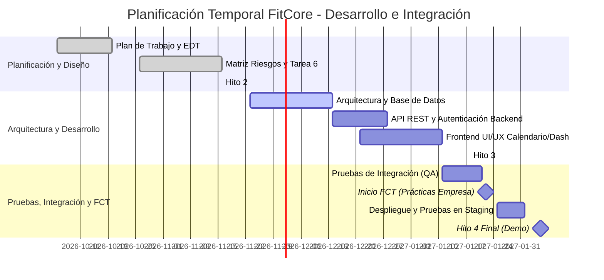

# FitCore SaaS - Plataforma de Gestión para Pequeños Gimnasios

Repositorio oficial del proyecto intermodular **FitCore** (2º DAW). Contiene la arquitectura base y el entornado local contenerizado mediante Docker y Docker Compose.

## Integrantes del Equipo
- Fernando Rosón de Mesa
- Eamonn S. Fitzgerald Valenzuela

## Requisitos Previos
- **Git** instalado en el sistema.
- **Docker Desktop** (o Docker Engine + Docker Compose v2) activo y en ejecución.

## Guía Paso a Paso para Levantar el Entornado en Local

1. **Clonar el repositorio:**
   git clone https://github.com/Rosfer111/FitCore-SaaS---Gesti-n-de-Gimnasios.git
   cd FitCore-SaaS---Gesti-n-de-Gimnasios

2. **Configurar las variables de entorno:**
   Copiar la plantilla .env.example para generar el fichero .env local:
   cp .env.example .env

3. **Construir y levantar los contenedores en segundo plano:**
   docker compose up -d --build

4. **Verificar el estado de los servicios:**
   docker compose ps

5. **Accesos locales disponibles:**
   - **Aplicación Web (Frontend):** http://localhost:5173
   - **API REST (Backend Healthcheck):** http://localhost:3000/api/health
   - **Base de Datos MySQL:** localhost:3306

6. **Detener el entorno:**
   docker compose down

## Alcance actual

Esta entrega configura el entorno base de desarrollo. El backend expone el endpoint de comprobación `GET /api/health` y el frontend sirve una página inicial estática; las funcionalidades de gestión se incorporarán en tareas posteriores.

## Planificación temporal

